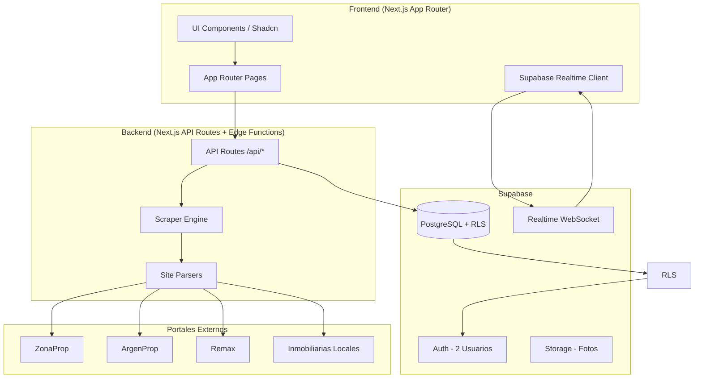

# 🏠 AppBuscaCasa — Plan de Implementación Completo

> Aplicación web de búsqueda, scraping y evaluación dual de propiedades inmobiliarias para La Plata, Berisso y Ensenada.

---

## 🏗️ Arquitectura General



---

## 📁 Estructura de Carpetas

```
d:\AppBuscaCasa\
├── app/
│   ├── (auth)/
│   │   ├── login/page.tsx
│   │   └── layout.tsx
│   ├── (dashboard)/
│   │   ├── layout.tsx                    # Nav + Sidebar
│   │   ├── page.tsx                      # Dashboard principal
│   │   ├── propiedades/
│   │   │   ├── page.tsx                  # Listado con filtros
│   │   │   └── [id]/page.tsx             # Detalle de propiedad
│   │   ├── fuentes/
│   │   │   └── page.tsx                  # Gestión de fuentes + Scraping
│   │   └── comparar/
│   │       └── page.tsx                  # Vista comparativa
│   └── api/
│       ├── scraper/
│       │   ├── route.ts                  # POST: trigger scraping
│       │   └── [source]/route.ts         # GET: estado del job
│       ├── properties/
│       │   └── route.ts                  # CRUD propiedades
│       └── ratings/
│           └── route.ts                  # CRUD calificaciones
├── components/
│   ├── ui/                               # Shadcn components
│   ├── properties/
│   │   ├── PropertyCard.tsx
│   │   ├── PropertyGrid.tsx
│   │   ├── PropertyFilters.tsx
│   │   └── PropertyDetail.tsx
│   ├── ratings/
│   │   ├── RatingModal.tsx               # Modal de calificación
│   │   ├── RatingSection.tsx             # Sección A/B/C
│   │   ├── StarRating.tsx                # Componente estrellas
│   │   └── BlindRatingStatus.tsx         # Indicador doble ciego
│   ├── scraper/
│   │   ├── ScraperForm.tsx               # Formulario URL
│   │   └── ScraperProgress.tsx           # Barra de progreso
│   └── shared/
│       ├── Navbar.tsx
│       ├── Sidebar.tsx
│       └── RealtimeIndicator.tsx
├── lib/
│   ├── supabase/
│   │   ├── client.ts
│   │   ├── server.ts
│   │   └── types.ts                      # Generated types
│   ├── scrapers/
│   │   ├── index.ts                      # Factory de parsers
│   │   ├── base-parser.ts
│   │   ├── zonaprop.ts
│   │   ├── argenprop.ts
│   │   ├── remax.ts
│   │   └── local-parsers.ts              # Inmobiliarias regionales
│   └── utils/
│       ├── price-formatter.ts
│       └── scoring.ts                    # Cálculo ponderado de scores
├── hooks/
│   ├── useRealtime.ts
│   ├── useProperties.ts
│   └── useRatings.ts
├── types/
│   └── index.ts
├── supabase/
│   ├── migrations/
│   │   └── 001_initial_schema.sql
│   └── seed.sql
├── public/
│   └── favicon.ico
├── .env.local
├── next.config.ts
├── tailwind.config.ts
└── package.json
```

---

## 🗄️ Esquema de Base de Datos (Supabase SQL)

### Tablas Principales

```sql
-- ============================================
-- USUARIOS (Perfil extendido de auth.users)
-- ============================================
CREATE TABLE public.profiles (
  id UUID REFERENCES auth.users(id) ON DELETE CASCADE PRIMARY KEY,
  display_name TEXT NOT NULL,
  avatar_url TEXT,
  role TEXT CHECK (role IN ('user_a', 'user_b')) UNIQUE NOT NULL,
  created_at TIMESTAMPTZ DEFAULT NOW()
);

-- ============================================
-- FUENTES DE SCRAPING
-- ============================================
CREATE TABLE public.real_estate_sources (
  id UUID DEFAULT gen_random_uuid() PRIMARY KEY,
  name TEXT NOT NULL,
  url TEXT NOT NULL,
  type TEXT CHECK (type IN ('portal', 'local_agency')) NOT NULL,
  connector_key TEXT NOT NULL, -- 'zonaprop' | 'argenprop' | 'remax' | 'aguirre' | etc.
  last_scraped_at TIMESTAMPTZ,
  scrape_status TEXT CHECK (scrape_status IN ('idle', 'running', 'success', 'error')) DEFAULT 'idle',
  properties_found INTEGER DEFAULT 0,
  created_by UUID REFERENCES auth.users(id),
  created_at TIMESTAMPTZ DEFAULT NOW()
);

-- ============================================
-- PROPIEDADES
-- ============================================
CREATE TABLE public.properties (
  id UUID DEFAULT gen_random_uuid() PRIMARY KEY,
  source_id UUID REFERENCES public.real_estate_sources(id) ON DELETE SET NULL,
  
  -- Datos básicos
  title TEXT NOT NULL,
  description TEXT,
  original_url TEXT,
  
  -- Ubicación
  address TEXT,
  locality TEXT CHECK (locality IN ('La Plata', 'Berisso', 'Ensenada', 'Otra')) DEFAULT 'La Plata',
  neighborhood TEXT,
  
  -- Económico
  price_usd NUMERIC(12, 2),
  expenses_ars NUMERIC(12, 2),
  
  -- Características
  surface_total_m2 NUMERIC(8, 2),
  surface_covered_m2 NUMERIC(8, 2),
  rooms INTEGER,
  bedrooms INTEGER,
  bathrooms INTEGER,
  garage BOOLEAN DEFAULT FALSE,
  
  -- Media
  photos JSONB DEFAULT '[]'::jsonb,  -- Array de URLs
  
  -- Estado de seguimiento
  status TEXT CHECK (status IN ('tracking', 'visited', 'discarded')) DEFAULT 'tracking',
  
  -- Metadata
  scraped_at TIMESTAMPTZ DEFAULT NOW(),
  added_by UUID REFERENCES auth.users(id),
  is_manual BOOLEAN DEFAULT FALSE,
  
  created_at TIMESTAMPTZ DEFAULT NOW(),
  updated_at TIMESTAMPTZ DEFAULT NOW()
);

-- ============================================
-- FAVORITOS (separado de properties para RLS dual)
-- ============================================
CREATE TABLE public.favorites (
  id UUID DEFAULT gen_random_uuid() PRIMARY KEY,
  property_id UUID REFERENCES public.properties(id) ON DELETE CASCADE NOT NULL,
  user_id UUID REFERENCES auth.users(id) ON DELETE CASCADE NOT NULL,
  created_at TIMESTAMPTZ DEFAULT NOW(),
  UNIQUE(property_id, user_id)
);

-- ============================================
-- CALIFICACIONES (Doble Ciego)
-- ============================================
CREATE TABLE public.ratings (
  id UUID DEFAULT gen_random_uuid() PRIMARY KEY,
  property_id UUID REFERENCES public.properties(id) ON DELETE CASCADE NOT NULL,
  user_id UUID REFERENCES auth.users(id) ON DELETE CASCADE NOT NULL,
  
  -- === SECCIÓN A: Ficha Técnica del Inmueble ===
  -- Instalación Eléctrica
  score_electrical INTEGER CHECK (score_electrical BETWEEN 1 AND 5),
  note_electrical TEXT,
  
  -- Gas y Calefacción
  score_gas INTEGER CHECK (score_gas BETWEEN 1 AND 5),
  note_gas TEXT,
  
  -- Plomería
  score_plumbing INTEGER CHECK (score_plumbing BETWEEN 1 AND 5),
  note_plumbing TEXT,
  
  -- Humedades y Filtraciones
  score_humidity INTEGER CHECK (score_humidity BETWEEN 1 AND 5),
  note_humidity TEXT,
  
  -- Aberturas y Aislamiento
  score_windows INTEGER CHECK (score_windows BETWEEN 1 AND 5),
  note_windows TEXT,
  
  -- Distribución y Luz Natural
  score_layout INTEGER CHECK (score_layout BETWEEN 1 AND 5),
  note_layout TEXT,
  
  -- === SECCIÓN B: Ficha Inmobiliaria y de Entorno ===
  -- Expensas y Costos Fijos
  score_expenses INTEGER CHECK (score_expenses BETWEEN 1 AND 5),
  note_expenses TEXT,
  
  -- Áreas Comunes
  score_common_areas INTEGER CHECK (score_common_areas BETWEEN 1 AND 5),
  note_common_areas TEXT,
  
  -- Barrio y Conectividad
  score_neighborhood INTEGER CHECK (score_neighborhood BETWEEN 1 AND 5),
  note_neighborhood TEXT,
  
  -- Potencial de Valorización
  score_appreciation INTEGER CHECK (score_appreciation BETWEEN 1 AND 5),
  note_appreciation TEXT,
  
  -- === SECCIÓN C: Ficha Legal y Financiera ===
  -- Situación de Dominio
  score_legal_title INTEGER CHECK (score_legal_title BETWEEN 1 AND 5),
  note_legal_title TEXT,
  
  -- Planos y Subdivisiones
  score_blueprints INTEGER CHECK (score_blueprints BETWEEN 1 AND 5),
  note_blueprints TEXT,
  
  -- Deudas
  score_debts INTEGER CHECK (score_debts BETWEEN 1 AND 5),
  note_debts TEXT,
  
  -- === Nota general ===
  general_notes TEXT,
  overall_impression INTEGER CHECK (overall_impression BETWEEN 1 AND 5),
  
  -- Estado
  submitted_at TIMESTAMPTZ,          -- NULL = borrador, NOT NULL = enviado
  
  created_at TIMESTAMPTZ DEFAULT NOW(),
  updated_at TIMESTAMPTZ DEFAULT NOW(),
  
  UNIQUE(property_id, user_id)
);
```

### Vista para Doble Ciego

```sql
-- ============================================
-- VISTA: Estado del Doble Ciego por propiedad
-- ============================================
CREATE OR REPLACE VIEW public.rating_status AS
SELECT
  p.id AS property_id,
  p.title,
  p.status,
  -- Usuario A
  ra.submitted_at IS NOT NULL AS user_a_submitted,
  ra.user_id AS user_a_id,
  -- Usuario B
  rb.submitted_at IS NOT NULL AS user_b_submitted,
  rb.user_id AS user_b_id,
  -- Estado calculado
  CASE
    WHEN ra.submitted_at IS NOT NULL AND rb.submitted_at IS NOT NULL 
      THEN 'completed'
    WHEN ra.submitted_at IS NOT NULL OR rb.submitted_at IS NOT NULL 
      THEN 'partial'
    ELSE 'pending'
  END AS blind_status,
  -- Scores solo visibles cuando ambos enviaron
  CASE
    WHEN ra.submitted_at IS NOT NULL AND rb.submitted_at IS NOT NULL
      THEN ra.overall_impression
    ELSE NULL
  END AS score_user_a,
  CASE
    WHEN ra.submitted_at IS NOT NULL AND rb.submitted_at IS NOT NULL
      THEN rb.overall_impression
    ELSE NULL
  END AS score_user_b
FROM public.properties p
LEFT JOIN public.ratings ra ON ra.property_id = p.id 
  AND ra.user_id = (SELECT id FROM auth.users WHERE raw_user_meta_data->>'role' = 'user_a' LIMIT 1)
LEFT JOIN public.ratings rb ON rb.property_id = p.id 
  AND rb.user_id = (SELECT id FROM auth.users WHERE raw_user_meta_data->>'role' = 'user_b' LIMIT 1);
```

### Políticas RLS

```sql
-- ============================================
-- ROW LEVEL SECURITY
-- ============================================

-- Habilitar RLS en todas las tablas
ALTER TABLE public.profiles ENABLE ROW LEVEL SECURITY;
ALTER TABLE public.properties ENABLE ROW LEVEL SECURITY;
ALTER TABLE public.favorites ENABLE ROW LEVEL SECURITY;
ALTER TABLE public.ratings ENABLE ROW LEVEL SECURITY;
ALTER TABLE public.real_estate_sources ENABLE ROW LEVEL SECURITY;

-- PROFILES: Ambos usuarios ven todos los perfiles
CREATE POLICY "profiles_select" ON public.profiles FOR SELECT TO authenticated USING (true);
CREATE POLICY "profiles_update" ON public.profiles FOR UPDATE TO authenticated USING (auth.uid() = id);

-- PROPERTIES: Ambos usuarios ven todas las propiedades
CREATE POLICY "properties_select" ON public.properties FOR SELECT TO authenticated USING (true);
CREATE POLICY "properties_insert" ON public.properties FOR INSERT TO authenticated WITH CHECK (auth.uid() = added_by);
CREATE POLICY "properties_update" ON public.properties FOR UPDATE TO authenticated USING (true);
CREATE POLICY "properties_delete" ON public.properties FOR DELETE TO authenticated USING (auth.uid() = added_by);

-- FAVORITES: Cada usuario ve y gestiona sus propios favoritos
CREATE POLICY "favorites_select" ON public.favorites FOR SELECT TO authenticated USING (true);
CREATE POLICY "favorites_insert" ON public.favorites FOR INSERT TO authenticated WITH CHECK (auth.uid() = user_id);
CREATE POLICY "favorites_delete" ON public.favorites FOR DELETE TO authenticated USING (auth.uid() = user_id);

-- RATINGS: Política de Doble Ciego
-- Lectura: Solo puedo ver mi propia calificación, O la del otro si ambos ya enviaron
CREATE POLICY "ratings_select" ON public.ratings FOR SELECT TO authenticated
USING (
  user_id = auth.uid()  -- Mi propia calificación siempre visible
  OR (
    -- La del otro solo si yo ya envié Y el otro también envió
    EXISTS (
      SELECT 1 FROM public.ratings my_rating
      WHERE my_rating.property_id = ratings.property_id
        AND my_rating.user_id = auth.uid()
        AND my_rating.submitted_at IS NOT NULL
    )
    AND ratings.submitted_at IS NOT NULL
  )
);
CREATE POLICY "ratings_insert" ON public.ratings FOR INSERT TO authenticated WITH CHECK (auth.uid() = user_id);
CREATE POLICY "ratings_update" ON public.ratings FOR UPDATE TO authenticated USING (auth.uid() = user_id AND submitted_at IS NULL);

-- REAL_ESTATE_SOURCES: Ambos ven y pueden agregar
CREATE POLICY "sources_select" ON public.real_estate_sources FOR SELECT TO authenticated USING (true);
CREATE POLICY "sources_insert" ON public.real_estate_sources FOR INSERT TO authenticated WITH CHECK (auth.uid() = created_by);
CREATE POLICY "sources_update" ON public.real_estate_sources FOR UPDATE TO authenticated USING (true);
```

### Funciones y Triggers

```sql
-- Auto-update del campo updated_at
CREATE OR REPLACE FUNCTION update_updated_at_column()
RETURNS TRIGGER AS $$
BEGIN NEW.updated_at = NOW(); RETURN NEW; END;
$$ LANGUAGE plpgsql;

CREATE TRIGGER update_properties_updated_at BEFORE UPDATE ON public.properties
  FOR EACH ROW EXECUTE FUNCTION update_updated_at_column();

CREATE TRIGGER update_ratings_updated_at BEFORE UPDATE ON public.ratings
  FOR EACH ROW EXECUTE FUNCTION update_updated_at_column();

-- Score ponderado calculado automáticamente (función)
CREATE OR REPLACE FUNCTION calculate_weighted_score(rating_id UUID)
RETURNS NUMERIC AS $$
DECLARE
  r public.ratings%ROWTYPE;
  score NUMERIC;
BEGIN
  SELECT * INTO r FROM public.ratings WHERE id = rating_id;
  
  -- Pesos: A=40%, B=35%, C=25%
  score := (
    -- Sección A (40%)
    COALESCE(r.score_electrical, 0) * 0.065 +
    COALESCE(r.score_gas, 0) * 0.065 +
    COALESCE(r.score_plumbing, 0) * 0.065 +
    COALESCE(r.score_humidity, 0) * 0.075 +
    COALESCE(r.score_windows, 0) * 0.065 +
    COALESCE(r.score_layout, 0) * 0.065 +
    -- Sección B (35%)
    COALESCE(r.score_expenses, 0) * 0.10 +
    COALESCE(r.score_common_areas, 0) * 0.05 +
    COALESCE(r.score_neighborhood, 0) * 0.125 +
    COALESCE(r.score_appreciation, 0) * 0.075 +
    -- Sección C (25%)
    COALESCE(r.score_legal_title, 0) * 0.10 +
    COALESCE(r.score_blueprints, 0) * 0.075 +
    COALESCE(r.score_debts, 0) * 0.075
  );
  
  RETURN ROUND(score, 2);
END;
$$ LANGUAGE plpgsql;
```

---

## 🚀 Roadmap de Implementación

### Fase 1 — Fundación (Semana 1)
- [x] Crear proyecto Next.js + Shadcn + Supabase
- [x] Configurar auth de 2 usuarios con Supabase
- [x] Implementar esquema de BD completo
- [x] Login page + middleware de autenticación

### Fase 2 — Core UI (Semana 1-2)
- [ ] Dashboard principal con stats
- [ ] Listado de propiedades con filtros (localidad, precio, estado)
- [ ] PropertyCard con estado de favorito en tiempo real
- [ ] PropertyDetail con galería de fotos

### Fase 3 — Scraper Engine (Semana 2-3)
- [ ] Base parser abstract class
- [ ] Connector ZonaProp (HTML parser)
- [ ] Connector ArgenProp
- [ ] Connector Remax
- [ ] Connectors inmobiliarias locales
- [ ] UI de gestión de fuentes + progreso

### Fase 4 — Sistema de Calificación (Semana 3)
- [ ] Modal de evaluación Sección A (Técnica)
- [ ] Modal de evaluación Sección B (Entorno)
- [ ] Modal de evaluación Sección C (Legal)
- [ ] Lógica de doble ciego + estado
- [ ] Vista de resultados comparados

### Fase 5 — Tiempo Real y Polish (Semana 4)
- [ ] Supabase Realtime para favoritos
- [ ] Notificaciones in-app cuando el otro usuario envía calificación
- [ ] Responsive mobile
- [ ] Deploy en Vercel

---

## 📦 Dependencias Principales

```json
{
  "dependencies": {
    "next": "15.x",
    "react": "19.x",
    "@supabase/supabase-js": "^2.x",
    "@supabase/ssr": "^0.x",
    "lucide-react": "^0.x",
    "cheerio": "^1.x",
    "axios": "^1.x",
    "zod": "^3.x",
    "zustand": "^5.x",
    "date-fns": "^3.x"
  },
  "devDependencies": {
    "typescript": "^5.x",
    "tailwindcss": "^3.x",
    "@types/node": "^20.x",
    "@types/react": "^19.x"
  }
}
```

---

## 🔌 Connectores de Scraping — Estrategia

| Portal | Estrategia | Notas |
|--------|-----------|-------|
| ZonaProp | Cheerio (HTML) + User-Agent rotation | Puede requerir bookmarklet para bypass |
| ArgenProp | Cheerio (HTML) | Más permisivo |
| Remax | API interna JSON (reverse-engineered) | Mejor opción |
| Aguirre Props | Cheerio (HTML) | Sitio local simple |
| Alquilarg | Cheerio (HTML) | |
| Kuligowski | Cheerio (HTML) | |
| Axion | Cheerio (HTML) | |
| Erica Mijailovsky | Cheerio (HTML) | |
| Ridella | Cheerio (HTML) | |
| STS Propiedades | Cheerio (HTML) | |
| Debona | Cheerio (HTML) | |

